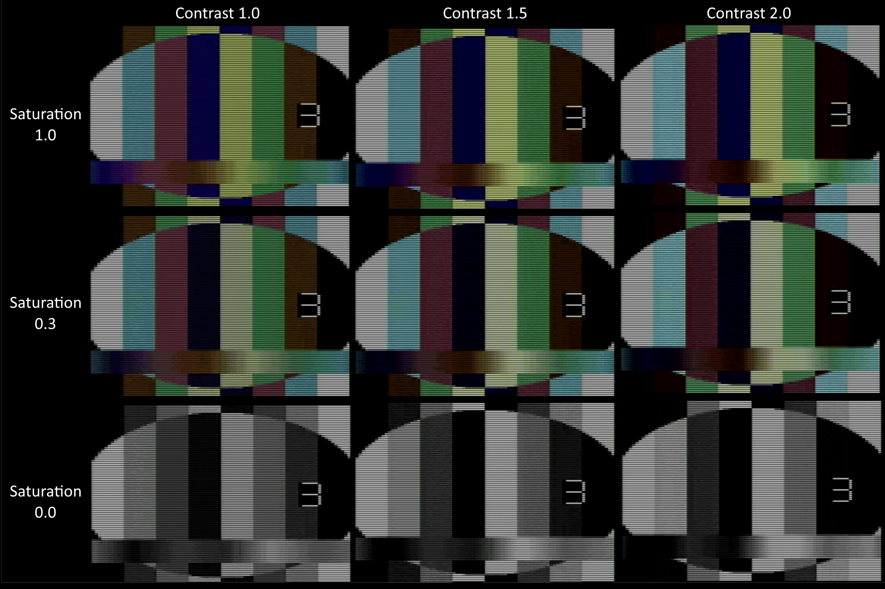
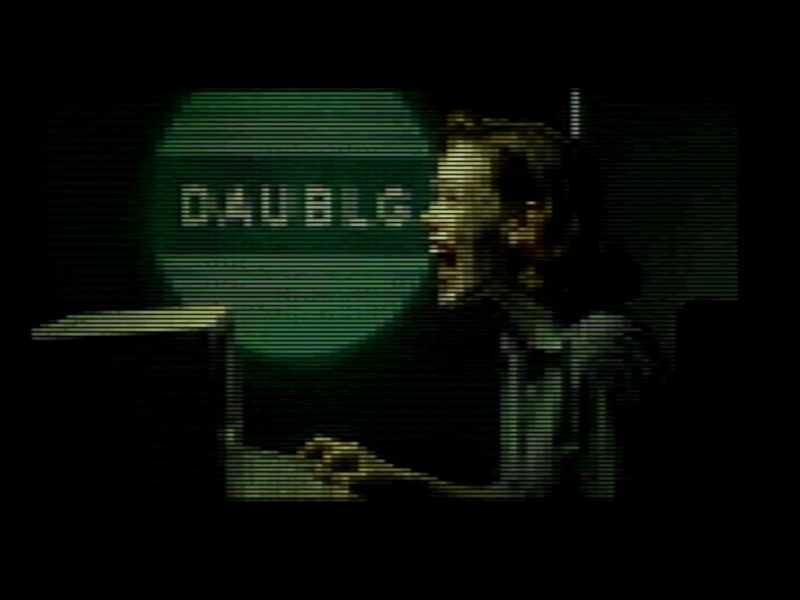
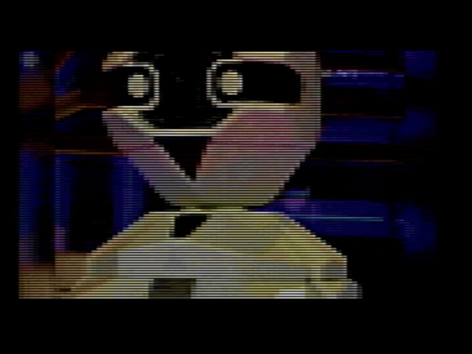
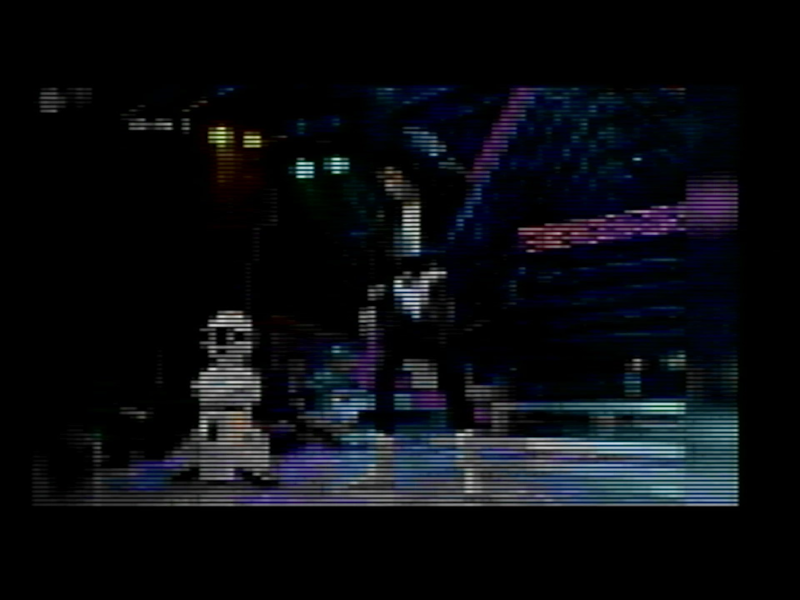

# avi2atari

A modern, all-in-one Python tool for converting video files into the **AVF** format used by **movplay** or [**AVFplay**](https://github.com/jhusak/avgcart_avfplay) on **Atari 8-bit** computers.

## Why use this tool?

Historically, creating video content for the Atari 8-bit was a painful, multi-step ritual:

ie.
1. Open video in **VirtualDub**.
2. Resize, change frame rate, and apply specific filters.
3. Export raw audio and raw video separately.
4. Run a specific C++ encoder for video (`encvideo`).
5. Run a separate C++ encoder for audio (`encaudio`).
6. Run a muxer (`mux`) to combine them.
7. Repeat everything if you wanted a different TV standard (PAL/NTSC).

**avi2atari** replaces this entire workflow with a **single command**.

### Key Features:

- **Pipeline Automation:** Uses FFmpeg for robust decoding of almost any input format (MP4, MKV, AVI, MOV, etc.).
    
- **High Performance:** Critical encoding loops are JIT-compiled using **Numba**, making it significantly faster than pure Python implementations.
    
- **Modern Audio Processing:** Implements **EBU R128 Loudness Normalization** (`--loudnorm`) to ensure audio is loud and clear without clipping - a common issue with manual volume adjustment on 8-bit DACs.
    
- **Dual System Support:** Generates correct frame structures for both **PAL (50Hz)** and **NTSC (60Hz)** systems.
    
- **Batch Processing:** Point it to a directory, and it will convert your entire library automatically.
  
- **Use URL as input:** Program supports URLs as input so you can process online videos (including YouTube) directly.
    
- **Structure Integrity:** Includes automated checks to ensure the output file has byte-perfect alignment required by the Atari player hardware. A standalone validator (`avf_check.py`) can re-verify any finished `.avf` file without booting an emulator.

## The PC-side AVF suite

avi2atari is now the home of a small **AVF/AVF2 tool suite**, tied
together by one shared format library (`avf_format.py`) so the converter,
validator and player can never disagree about the container layout:

| Tool | Command | Role |
|------|---------|------|
| converter | `avf convert <video> [opts]` | video -> AVF/AVF2 (this tool) |
| validator | `avf check <file.avf>` | verify the binary layout, no emulator needed |
| player | `avf play <file.avf>` | play in a desktop window (needs pygame) |
| metadata | `avf meta <file.avf>` | print AVF2 metadata (no pygame needed) |

Tools in this repo:

- **`avi2atari.py`** - the converter. FFmpeg-fed pipeline, Numba-JIT
  encode loops, PAL/NTSC, APAC and AVF-C80 profiles, AVF2 metadata,
  batch and URL input.
- **`avf_check.py`** - structural validator: confirms the on-disk byte
  layout (header, frame size, block/pad structure) without an emulator.
- **`avfplayer.py`** - desktop player (pygame): plays AVF/AVF2 in a
  window with an encoder-exact GTIA palette, live phase/saturation
  tuning, scanlines, blending and looping.
- **`avf_format.py`** - the shared library every tool imports (header
  build/parse, checksum, frame demux, RGB decoders, Legacy->AVF2).
- **`avf.py`** - umbrella CLI: `convert | check | play | meta`.
- **`web/`** - the FastAPI web UI (see below).

`avf.py` is an umbrella CLI over the four; each still runs standalone
(`python avi2atari.py ...`, `python avf_check.py ...`,
`python avfplayer.py ...`). The **AVF2** metadata format is the
recommended default; a plain headerless AVF v1 stream is referred to as
**Legacy**. Both APAC and the true-colour **AVF-C80** (GTIA2RGB COL80
Mode 4) profiles are understood across the whole suite.

### Inspecting and editing metadata

```
avf meta film.avf                              # show AVF2 metadata (or "Legacy")
avf meta film.avf --set-title "My Reel" --set-author "Me"   # edit in place
avf meta film.avf --set-comment "note" --out copy.avf       # ...or to a copy
```

Upgrade a **Legacy** (plain v1) file to **AVF2** - the TV system is a
manual choice because a v1 stream carries no marker for it:

```
avf meta legacy.avf --to-avf2 --system PAL --set-title "Title"         --poster-frame 250 --out titled.avf
```

`--poster-frame N` lifts frame N's picture into the poster; omit it for
no poster. The video payload is never re-encoded - only the 8 KB header
changes - so the upgrade is instant and lossless.

## Web GUI (self-host)

A FastAPI web front-end wraps the whole suite - convert (single or
batch -> zip), inspect/edit metadata, upgrade Legacy -> AVF2, and a
server-side PNG preview - reusing the exact CLI converter and the shared
`avf_format` library. It is **RAM-only**: scratch lives on tmpfs and
nothing about a conversion is persisted (only the client IP and the
submitted file names are logged, for abuse prevention; the UI shows a
disclaimer when `SERVER_MODE=1`).

**Easiest path (one click):** run `webui.bat` (Windows) or `./webui.sh`
(Linux/macOS). It creates a local `.venv`, installs the web dependencies
and opens the UI at http://127.0.0.1:8000 - URL/YouTube input is enabled
by default on a local run.

Or by hand:

```
pip install -r requirements.txt
python web/app.py                              # http://127.0.0.1:8000
```

Or with Docker + traefik (copy the examples, then bring it up):

```
cp .env.example .env                 # set DOMAIN, toggles
cp docker-compose.yml.example docker-compose.yml
docker compose up -d --build
```

`YOUTUBE_ENABLED=1` turns on URL input (a local `python web/app.py` run
enables it by default). AVF2 is the default output format; a plain v1
stream is called **Legacy** throughout the UI. The whole suite installs
from one `requirements.txt` (ffmpeg is a separate system dependency).

## Installation

### The easy way (If you are Windows user and not sure what to do):

Open the Command Prompt, then:

    winget install Python.Python.3.10
    winget install ffmpeg
    winget install Git.Git
    git clone https://github.com/HanJammer/avi2atari.git
    cd avi2atari
    python -m pip install -r requirements.txt
    python avi2atari.py --test-gen --system PAL

**YouTube instructions:**

[Rusty Bits - avi2atari - a modern converter for 8-bit Atari AVF files](https://www.youtube.com/watch?v=e5cW2JG56zw)

[](https://www.youtube.com/watch?v=e5cW2JG56zw)

### The regular (recommended) way:

Install prerequisities:

**Python 3.8+** (Python 3.10 recommended)

**FFmpeg**: You must have FFmpeg installed and added to your system's PATH.
 - _Windows:_ Download from [ffmpeg.org](https://ffmpeg.org/) (official site) or [gyan.dev](https://www.gyan.dev/ffmpeg/builds/#release-builds) (prebuilt binaries with codecs included), extract, and add the `bin` folder to your System Environment Variables (PATH).
 - _Linux:_ ie. `apt install ffmpeg`

Then:

1. **Clone the repository:**
    
    ```
    git clone https://github.com/HanJammer/avi2atari.git
    cd avi2atari
    ```
    
2. **Create a Virtual Environment (Recommended):**
    
    - **Windows (Command Prompt / PowerShell):**
        
        ```
        python -m venv venv
        .\venv\Scripts\activate
        ```
        
    - **Linux / macOS:**
        
        ```
        python3 -m venv venv
        source venv/bin/activate
        ```
        
3. **Install dependencies:**
      
    ```
    pip install -r requirements.txt
    ```

---

## Usage

### Basic Conversion

Convert a single video file to PAL format (default):

```
python avi2atari.py video.mp4 --system PAL
```

### Batch Processing

Convert all videos in a specific folder:

```
python avi2atari.py D:\MyVideos\ --system PAL
```

### URL as input

Convert online video:

```
python avi2atari.py https://some.online/video.mp4
```

### URL list as input

Convert online videos you specified in the file. File format is: one URL per line and optional output file name (tab-separated).
URL<tab>OutputFileName
URL2
URL3<tab>SomeotherFileName

```
python avi2atari.py --urllist onlinevideos.txt
```

### The "Golden Standard" (Recommended)

Use loudness normalization and slightly boost saturation for better visuals on CRT screens:

```
python avi2atari.py matrix.mp4 --system PAL --loudnorm --saturation 1.3
```

### Generate Test Signal

Create a synthesized test file (SMPTE bars + 440Hz tone) to verify your hardware/cabling:

```
python avi2atari.py --test-gen --system PAL
```

### AVF2 metadata header

`--avf2` writes an ID3-like metadata block (title, author, converter, date,
duration and a full-resolution poster frame) into the 8KB header region that
every existing player skips unconditionally - so AVF2 files remain **100%
playable** by movplay/AVFPLAY and all other AVF v1 consumers:

```
python avi2atari.py matrix.mp4 --system PAL --loudnorm --avf2 --title "The Matrix (1999)" --author "HanJammer"
```

The poster frame is taken at 10% of the source duration by default; use
`--poster SECONDS` to pick a different moment. Without `--title` the source
filename is used. `avf_check.py` validates and prints the metadata;
[avfplayer](https://github.com/HanJammer/avfplayer) can display it
(`--info`, `--poster`).

### Validate a finished AVF file

`avf_check.py` is a standalone structural validator. It reads a finished `.avf`
file and confirms that its binary layout matches exactly what `movplay`/`AVFplay`
expect on the Atari - **without** booting an emulator or real hardware. Use it as a
fast regression check after tweaking encoder settings, or to confirm a file
survived copying/transfer intact.

It checks:

- the optional 8 KB header is present and either fully zeroed (AVF v1) or a
  valid AVF2 metadata block (magic, checksum, system and frame count are
  cross-checked against the actual payload; metadata is printed),
- the payload length is an exact multiple of the 8704-byte frame size,
- the fixed padding bytes inside every video block are zero,
- the audio-block tail padding matches the target system (PAL/NTSC differ here).

```
# Validate a PAL file produced with the default 8KB header:
python avf_check.py video-PAL.avf --system PAL

# NTSC file:
python avf_check.py video-NTSC.avf --system NTSC

# A file produced with --no-header:
python avf_check.py raw.avf --no-header --system PAL
```

It prints a short report and exits `0` on success or `1` on the first structural
problem it finds (handy in scripts/CI). `--system` defaults to `PAL`; it only
affects the audio tail-padding pattern, so pass the correct one for NTSC files.

---

## Parameters

```
usage: avi2atari.py [-h] [--test-gen] [--urllist] [--system {PAL,NTSC,BOTH}] [--out OUT] [--no-header] [--saturation SATURATION] [--contrast CONTRAST] [--aspect {stretch,fit}] [--volume VOLUME | --loudnorm] [input]
```

| **Parameter**  | **Description**                                                                                                                                                                                       |
| -------------- | ----------------------------------------------------------------------------------------------------------------------------------------------------------------------------------------------------- |
| `input`        | Input video file path OR a directory for batch processing.                                                                                                                                            |
| `--system`     | Target system: `PAL`, `NTSC`, or `BOTH` (generates two files). Default: `BOTH`.                                                                                                                       |
| `--out`        | Custom output filename (ignored in batch mode).                                                                                                                                                       |
| `--loudnorm`   | **Recommended.** Enables EBU R128 loudness normalization. Ensures consistent volume without distortion.                                                                                               |
| `--urllist`    | Takes text file with list of the URLs as an input (described above).                                                                                                                                  |
| `--volume`     | Manual volume gain in dB (e.g., `10`). Use only if loudnorm is disabled. Default: `12.0`.                                                                                                             |
| `--saturation` | Color saturation. `1.0` is original. Values above `1.0` boost color (e.g. `1.5` is a visible boost, good for washed-out sources on a CRT); `0.0` gives monochrome video.                                |
| `--contrast`   | Contrast adjustment. `1.0` is default.                                                                                                                                                                |
| `--aspect`     | How to fit the source into 160x192: `stretch` (default, fills the frame - legacy behaviour) or `fit` (preserves the source aspect ratio and adds black bars). Use `fit` for 16:9 content to avoid squashing. |
| `--avf2`       | Write the AVF2 metadata header (backward compatible - see above).                                                                                                                                      |
| `--title`      | AVF2: video title (ASCII, max 64 chars). Default: source filename.                                                                                                                                     |
| `--author`     | AVF2: author of the conversion (ASCII, max 64 chars).                                                                                                                                                  |
| `--comment`    | AVF2: free-text comment (ASCII, max 128 chars).                                                                                                                                                        |
| `--poster`     | AVF2: source timestamp (seconds) of the poster frame. Default: 10% of duration.                                                                                                                        |
| `--no-header`  | Disables the 8KB blank header. **Warning:** This is test/debug option! Only use this if you know exactly how your loader works. Most players (like `movplay`) require the header for synchronization. |
| `--test-gen`   | Generates a `test_tone.mp4` file and converts it. Useful for debugging audio issues and tuning contrast/saturation.                                                                                   |

### Parameter Comparison

**Saturation vs Contrast matrix**



### Output examples

**"DAUBLG Makes it Right!"** ([source video](https://www.youtube.com/watch?v=Pq7VeyPghbY)).

Download AVF: [PAL](https://drive.google.com/file/d/1xqwC5dUnTEuFpL4qeniVdj2TtK0Gm0vs/view?usp=sharing) [NTSC](https://drive.google.com/file/d/1UhUVOQMtQdMp4kDoz1Lhlnayg7lL8b0n/view?usp=sharing)

| **Sample 1**                                  | **Sample 2**                                  |
| ----------------------------------------------| --------------------------------------------- |
|  |  |

**Topo & Roby "Under the Ice" (Live)** ([source video](https://www.youtube.com/watch?v=iR7pwtqyZio)).

| **Sample 1**                                          | **Sample 2**                                          |
| ------------------------------------------------------| ----------------------------------------------------- |
|  |  |

---


## Desktop player (avfplayer)

`avf play file.avf` (or `python avfplayer.py file.avf [PAL|NTSC]`) opens a
window. It derives its palette as the exact mathematical inverse of the
encoder's YIQ model, so at the defaults the colours are what the encoder
"meant"; both are live-tunable to match your reference hardware by eye.

| Key | Action |
|-----|--------|
| `S` | scanlines on/off (default on) |
| `B` | pixel blending on/off (default on) |
| `[` / `]` | tune colour phase (hue) in 0.05 rad steps (0 = encoder-exact) |
| `Shift+[` / `Shift+]` | tune saturation (1.0 = the Atari's chroma; ~2.0 = punchier) |
| `L` | loop |
| `D` | oscilloscope overlay |

`--info` prints AVF2 metadata and exits; `--poster` shows the poster
frame before playback; `--scale N` sets the window scale (3 default,
8 fills a 4K screen). This player was previously the standalone
`avfplayer` repository, now merged into the suite.

## Limitations & Hardware Notes

I tested the output files extensively on my Atari 130XE with SUB Cart (yet to be tested on my 800XL).

1. **Storage Speed:** Playing AVF video requires a data transfer rate of approx. **8.7 KB/frame** (over 430 KB/s). This requires fast storage solutions like **SUB Cart** (tested), **AVG Cart** (not tested but should work just like SUB Cart), **SIDE2/3** (needs testing - SIDE2/SIDE3 do not play AVF "natively". You need an AVF player that supports SIDE access and the correct filesystem setup). Standard floppy emulators (SIO2SD) are too slow. If playback glitches: try a freshly formatted FAT16 card and copy AVF files first to keep them contiguous (fragmentation breaks streaming).
    
2. **Emulator Configuration:** If testing on **Altirra**, you MUST enable **"Use burst I/O transfers"** in the Hard Disk configuration. Without it, the emulator simulates seek times, causing video glitches. It's very likely to glitch-out/lose synchronisation anyway.
    
3. **Audio Quality:** The audio is essentially 4-bit software PCM played through the POKEY chip. A high-pitched carrier whine (~15kHz) is normal and part of the technology, not a bug.
    
4. **Color Palette:** The Atari GTIA chip has a limited palette. The converter uses dithering to simulate more colors, but some degradation (especially in reds) is expected compared to the source material.

---

## Contributing

This tool was created to modernize the Atari 8-bit video ecosystem.

Testing and debugging was done on the PAL hardware only. NTSC is mostly untested - if you have NTSC computer and can test the output AVFs - this would be a great help to make this program better.

If you find bugs or have ideas for better dithering algorithms:

1. Fork the repo.
    
2. Create your feature branch.
    
3. Submit a Pull Request.

**Credits:**

- Original concept: phaeron encvideo/encaudio/mux C++ sources.
    
- Python Port & Engineering: HanJammer & Lumen.
    
- Special thanks to MNEMOS for AVF format structural analysis.

**Happy streaming!**
